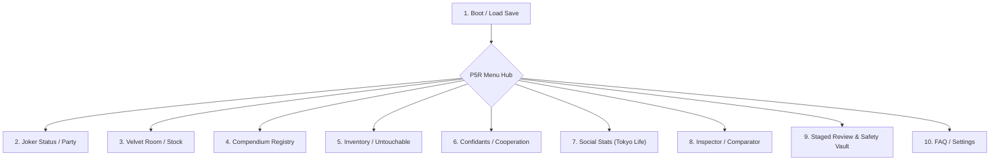

# CHANGE OF HEART 2.0 — OPENDESIGN HANDOFF & ARCHITECTURAL CONTRACT
## Official Design Handoff, Technical Interface Specification & Rejection Analysis

**Project:** Change of Heart 2.0 — Persona 5 Royal Save Studio  
**Repository:** `https://github.com/j0nnyDiGITAL/change-of-heart`  
**Review PR:** `https://github.com/j0nnyDiGITAL/change-of-heart/pull/7`  
**Current Review Branch:** `feature/change-of-heart-2.0`  
**Date:** October 16, 2026  
**Engineering Authority:** Antigravity  
**Visual Design Authority:** OpenDesign  
**Final Approval Authority:** Repository Owner (j0nnyDiGITAL)  

---

# 1. EXECUTIVE CHARTER & GOVERNANCE

The owner has explicitly rejected the Phase E visual redesign. The previous visual direction—characterized by a conventional web dashboard, vertical sidebar navigation, repetitive rectangular card grids, and uniform heavy typography—failed owner review. 

This document establishes the official separation of responsibilities:
- **Antigravity (Engineering Authority):** Owns binary save handling, dual-layer CRC32 checksums, AES-256 cryptography, two-phase atomic file replacement, transactional session management, loopback security, regression test suites, Windows packaging, and backend-frontend technical contracts.
- **OpenDesign (Visual Design Authority):** Owns visual art direction, authentic Persona 5 Royal reference analysis, scene-specific screen compositions, character artwork integration, typography contrast, interaction choreography, and high-fidelity prototype iteration.
- **Owner (Final Approval Authority):** Exclusively holds final sign-off on visual direction, reference fidelity, interactive prototypes, major revisions, and release readiness.

**Directive to OpenDesign:** Do not attempt to style or polish the rejected dashboard layout. The visual architecture must be rebuilt from the ground up based on authentic in-game Persona 5 Royal menu compositions.

---

# 2. PRODUCT AND ARCHITECTURE OVERVIEW

### 2.1 Runtime Environment
Change of Heart is a native Windows desktop save editor operating as a hybrid application:
1. **Desktop Host:** `main.py` initializes a desktop WebView2 window (via `pywebview`) with an automated fallback to the user's default web browser if WebView2 runtime initialization fails or drops heartbeat check-ins.
2. **Local HTTP Server:** `server.py` binds to loopback (`127.0.0.1`) on an ephemeral port (default 3000), serving the single-page application frontend (`web-app/templates/index.html`, `static/app.js`, `static/app.css`).
3. **Packaging:** Frozen standalone Windows executable (`dist/P5R_Save_Editor.exe`) compiled with PyInstaller, containing zero external CDN dependencies. All scripts, fonts, stylesheets, and fallback SVGs are self-contained.

### 2.2 Client-Server Communication & Security Model
All frontend operations interact with the Python backend via JSON over HTTP:
- **Capability Authentication:** Every loaded save establishes an isolated session with a cryptographically secure 24-byte capability token (`secrets.token_hex(24)`). Mutating endpoints (`/api/save`, `/api/restore`, `/api/stage`, `/api/transfer`) require this token in the `X-Session-Token` HTTP header.
- **DNS Rebinding & CSRF Protection:** The server strictly verifies the `Host` header (loopback only) and blocks cross-origin requests by enforcing loopback `Origin` checks.
- **Input Hardening:** 32 MB request body limit, 5 MB save file upload limit, Content-Security-Policy header (`default-src 'self'`), and zip-slip path traversal guards on backup extraction.

### 2.3 Two-Phase Transactional Save Workflow
Direct disk overwriting is prohibited. When saving:
1. All pending user modifications are applied in memory to a disposable `SaveEditor` clone.
2. The candidate save bytes are packed, re-encrypted with AES-256-CBC, and signed with outer/inner CRC32 checksums.
3. The candidate bytes are written to a unique temporary file (`.coh_tmp_*`) in the target directory and flushed to disk (`os.fsync`).
4. The temporary file is re-parsed and verified.
5. The existing save on disk is checked against the session's baseline SHA-256 hash. If another process (or a running `P5R.exe`) modified the file externally, a concurrency conflict (`HTTP 409`) is raised.
6. The temporary file atomically replaces the target save via `os.replace` (backed by a 5-step bounded exponential backoff loop for Windows file-locking/antivirus contention).
7. Active session memory updates only after physical readback verification confirms identical SHA-256 persistence.

---

# 3. COMPLETE FUNCTIONAL INVENTORY

The new visual design created by OpenDesign must maintain full feature parity with the existing backend capabilities. No functional feature may be dropped.

| Screen / Feature | Current Functional Capabilities | Backend Endpoints | Editable Fields | Read-Only Fields / Safety Invariants |
| :--- | :--- | :--- | :--- | :--- |
| **1. Boot / Save Loading** | Steam directory auto-discovery, custom file browser (`DATA.DAT`/`DATA.BIN`), web-upload decoding, save metadata preview. | `GET /api/discovery`, `POST /api/load`, `POST /api/load-upload` | Selected save slot path. | Steam directory paths, discovered file timestamps. |
| **2. Leader & Stats (Daily Life)** | Protagonist identity, Phantom Thief group calling name, Yen balance, Calendar date, Playtime, Difficulty. | `GET /api/state`, `POST /api/save` | First Name (UTF-8), Last Name (UTF-8), Group Name (UTF-8), Yen (`0`–`9,999,999`), Difficulty. | Days elapsed, Calendar day string, in-game playtime counter. |
| **3. Social Stat Meters** | 5 core Joker personality attributes: Knowledge, Charm, Proficiency, Guts, Kindness. | Handled via save modification payload (`social_stats`). | Stat Ranks (1 to 5). Behind the scenes, mapped to internal point thresholds (`0x139E0`). | Underlying exact point values (auto-synced to rank minimums). |
| **4. Velvet Room & Party** | Joker's 12 equipped Persona stock slots (`0x07158`), 9 teammate combat stats, HP/SP restoration, Level editing. | Handled via save modification payload (`party`, `joker_stock`). | Persona ID, Level (1–99), Trait ID, EXP, 8 Skill Slot IDs, 5 Stats (St, Ma, En, Ag, Lu). Teammate levels, HP/SP, equipped Persona stats. | Party member roster slots (0–9 locked to story characters). Teammate Persona IDs are fixed by story evolution. |
| **5. Compendium Registry** | Visual catalog of all 224 compendium personas, registration toggles, 100% full compendium unlock button. | `POST /api/save` (`unlock_compendium`, `compendium.registered`) | Individual Persona registration bits (0 or 1), 100% Unlock All. | Unmapped 2,496-byte gap regions (`0x09460` and `0x21970`) are bitwise preserved without zeroing. |
| **6. Hideout & Inventory** | Unified item management: 7 categories (Melee, Ranged, Armor, Accessories, Consumables, Skill Cards, Materials). | `POST /api/save` (`inventory_normalized`) | Stack quantities (0–99), Gear ownership flags (0 or 1). Quick Max buttons, item addition. | Outfits (`0xA000+`) are strictly frozen read-only per D008. Master item array count limits preserved. |
| **7. Confidants & Cooperation** | 23 Confidant Arcanas, rank steppers (0–10), lover/friend romance toggles, narrative cutoff warnings. | Handled via save modification payload (`confidants`). | Rank (0–10), Romance state (Boolean for 10 eligible partners), Max All convenience button. | Story deadline dates (Maruki 11/18, Akechi 11/17, Yoshida 11/13, Yoshizawa Rank 5 cap). 3rd Semester Event Flag Matrix (43,008 bits) is frozen read-only per D009. |
| **8. Save Inspector (Diagnostics)** | Deep container inspection: outer header magic, file CRC32, payload CRC32, AES flag, compendium mirror parity, running game process. | `GET /api/inspect` | None (Diagnostic Read-Only). | Grade A/Degraded status, byte offsets, CRC matches, mirror synchronization state, process lock alerts. |
| **9. Save Comparator & Transfer** | Side-by-side semantic difference table + byte-range diffing against secondary save; selective module transfer (Money, Stats, Compendium, Inventory). | `POST /api/compare`, `POST /api/transfer` | Selective transfer category checkboxes (Money, Social Stats, Compendium, Inventory). | Divergent byte counts, classified binary diff regions, comparison donor save source bytes. |
| **10. Staged Review & Backups** | Pending modification review ledger before commit; timestamped ZIP snapshots before save; 1-click rollback. | `GET /api/stage`, `POST /api/stage`, `GET /api/backups`, `POST /api/restore` | Staged changes clear/commit, Backup file selection for restore. | Safety backup zip generation, path-traversal validation, baseline SHA-256 verification. |

---

# 4. DESIGN REJECTION REPORT — WHAT FAILED AND WHY

The owner rejected the Phase E redesign based on direct screenshot evidence. OpenDesign must understand these architectural flaws to avoid repeating them.

```
+------------------------------------------------------------------------------------+
|                         REJECTED DESIGN BASELINE FLAWS                             |
|                                                                                    |
|  [ TOP STRIP: LOAD SAVE | REFRESH | BROWSE... | INSPECT | COMPARE | FAQ | FX ]    |
|  +--------------------+---------------------------------------------------------+  |
|  | [NAV SIDEBAR]      | [GENERIC RECTANGULAR CARD]                              |  |
|  | - Daily Life       | Title: LEADER PROFILE                                   |  |
|  | - Velvet Room      | Input: First Name [________] Last Name [________]       |  |
|  | - Confidants       | Input: Group Name [________] Wallet [________]          |  |
|  | - Inventory        +---------------------------------------------------------+  |
|  | - Compendium       | [GENERIC RECTANGULAR CARD]                              |  |
|  | - God Presets      | Title: SOCIAL STAT METERS                               |  |
|  | - Safety Vault     | Knowledge [★][★][★][★][★]  Charm [★][★][★][★][★]       |  |
|  +--------------------+---------------------------------------------------------+  |
|                                                                                    |
|  STRUCTURAL VERDICT: Conventional SaaS / Admin Dashboard with P5R-colored CSS.     |
+------------------------------------------------------------------------------------+
```

### 4.1 Dashboard-Style Layout Architecture
The interface relied on a permanent vertical left sidebar navigation and a persistent horizontal top toolbar. This structure belongs to web productivity software or enterprise dashboards. Persona 5 Royal menus never look or navigate like admin panels.

### 4.2 Repetitive Rectangular Card Containers
Content was grouped into modular rectangular boxes (`.p5-card`, `.audit-card`) arranged in 2-column or 3-column CSS grids. Simply skewing a rectangular container by `-10deg` does not make it authentic P5R design. P5R uses asymmetrical shards, dynamic perspective convergence, overlapping cutouts, and hand-cut paper collages.

### 4.3 Missing Character-Driven Composition
In Persona 5 Royal, characters are not boxed thumbnails inside cards—they anchor the screen composition. Joker's dynamic stance, dramatic angles, trench coat silhouettes, and high-contrast cutouts should dominate the space. In the rejected design, artwork was reduced to small square thumbnails inside rigid tables.

### 4.4 Typography Monoculture & Poor Hierarchy
Heavy, uppercase display text was applied everywhere indiscriminately. There was insufficient typographic contrast between expressive display titles, readable system descriptions, numerical values, and confirmation prompts. When every element screams in bold uppercase, nothing has emphasis.

### 4.5 Environmental Sameness
Every stage looked identical in structure: same sidebar on the left, same red banner title on the right, same black cards below. In P5R, each menu environment has its own deliberate visual identity:
- The **Velvet Room** is a cold, blue gothic prison with velvet textures, heavy cell bars, and guillotine blades.
- **Untouchable Airsoft** is a dark, tactical, lime-green and military gunmetal workshop with stencil lettering and camouflage accents.
- **Daily Life** is warm, journalistic, and urban, capturing Tokyo subway maps, school chalkboards, and newspaper cutouts.

---

# 5. DESIGN REFERENCE INVENTORY

OpenDesign must base all visual work strictly on genuine Persona 5 Royal references available in the repository.

### 5.1 Local Reference Screenshots (`design/reference/`)
The repository contains 100+ authentic 1080p game UI screenshots and contact sheets. Key references to analyze:

| Reference ID | Relative Path | Target Screen / Scene | Key Compositional Elements |
| :--- | :--- | :--- | :--- |
| **Status / Stats** | `design/reference/Persona-5-Royal03112021-110211-15585.jpg` | Joker Status & Party | Full-height dynamic Joker cutout, angled white polygon name card, stat polygon shard, diagonal red slash backdrop. |
| **Combat Stats** | `design/reference/Persona-5-Royal03112021-110122-41845.jpg` | Stats & Level Deck | High-contrast neon cyan combat shards, slanted HP/SP gauges, bold level placard. |
| **Velvet Room** | `design/reference/Persona-5-Royal03112021-110122-28140.jpg` | Velvet Room & Fusion | Deep velvet blue/cyan palette, gothic iron gate framing, ornate French typography, cell bar dividers. |
| **Airsoft Shop** | `design/reference/Persona-5-Royal03112021-110212-30894.jpg` | Inventory & Equipment | Tactical gunmetal and neon-lime palette, stencil labels, pocket pouch tab folders, military dossier aesthetics. |
| **Confidant Dossier**| `design/reference/Persona-5-Royal03112021-110213-50281.jpg` | Confidants / Cooperation | Amber-gold tarot card spreading, dynamic character silhouette, star progression track, bond milestone cards. |
| **Menu Ticker** | `design/reference/Persona-5-Royal03112021-110214-63538.jpg` | Navigation Ribbon | Running navigation tape with skewed black/white text tags, sharp red pinpoints, dynamic hover expansion. |
| **Contact Sheets**| `design/reference/contact_sheets/sheet_01.png` .. `sheet_08.png` | Complete UI System | Contact sheets compiling official Atlus typography, dialogue boxes, alert stamps, button prompts, and modal styling. |
| **Reference Index**| `design/reference/gud_index.md` | Full Index | 377-line markdown index cataloging every reference screenshot by category. |

### 5.2 Local Extracted Assets (`web-app/static/assets/`)
The following local art assets are already extracted and available for offline client rendering:
- **Persona Artwork:** 232 character PNGs located in `web-app/static/assets/personas/` (`1.png` to `461.png`).
- **Confidant Standees:** 24 full-body standees in `web-app/static/assets/confidants_full/` and portrait thumbnails in `web-app/static/assets/confidants/`.
- **Party Members:** Official party portraits in `web-app/static/assets/party/`.
- **Brand & Theme Assets:** `change_of_heart_logo.jpg`, custom SVG iconography in `web-app/static/assets/icons/`.

### 5.3 Intellectual Property & Asset Policy
- **No External Downloading:** OpenDesign must not download external copyrighted fonts, audio, video, or textures.
- **Standalone Offline Fallbacks:** The UI must maintain 100% functionality and clean visual appeal using embedded SVG, CSS transforms, and standard system font stacks (`Impact`, `Arial Black`, `Trebuchet MS`, sans-serif) when running in distribution mode.

---

# 6. VISUAL TARGET & DESIGN REQUIREMENTS

OpenDesign must craft an interface that feels like navigating Persona 5 Royal's actual game engine menus.

### 6.1 Priority Design Characteristics
1. **Asymmetric, Scene-Specific Composition:** Eliminate uniform card grids. Each screen must have an asymmetrical layout anchored by character illustration, environmental perspective, or diagonal slash planes.
2. **Character-Driven Visual Hierarchy:** Major character artwork (Joker, Velvet Wardens, Iwai, Takemi) must serve as large, expressive focal points, interacting directly with menu shapes rather than sitting in tiny avatar boxes.
3. **Dramatic Perspective & Layering:** Background graphic layers, halftone polka dots, comic-book hatching, and skewed text elements must create visual depth. Foreground interactive elements should overlap background geometry.
4. **Distinctive Typography Hierarchy:**
   - **Display / Titles:** Oversized, punk cut-paper typography with skewed bounding angles and drop shadows.
   - **Field Labels:** Crisp, clean, legible geometric lettering.
   - **Numerical Data & Counters:** High-contrast, tabular figures for currency, stats, and item quantities.
   - **Descriptive Text:** Highly readable, comfortably spaced body text.
5. **Distinct Environmental Theming:**
   - **Daily Life:** Red, black, and white punk aesthetic with Shibuya street energy.
   - **Velvet Room:** Indigo blue, cyan, velvet textures, and prison cell geometry.
   - **Inventory:** Gunmetal gray, army green, and stencil textures inspired by Untouchable Airsoft.
   - **Confidants:** Amber gold, black tarot framing, and elegant Cooper-style arcana accents.

---

# 7. REQUIRED SCREEN SPECIFICATIONS

OpenDesign will prototype designs for the following 10 functional spaces:



### Screen 1: Boot & Save Selection
- **Role:** File discovery, slot selection, and save loading.
- **Visual Reference:** P5R Title Screen / Save Load Calendar screen (`Persona-5-Royal03112021-110111-77734.jpg`).
- **Required Elements:** Stylized save slot cards displaying Protagonist name, calendar date, playtime, yen, and integrity badge; Steam discovery rescan button; manual browse button; drag-and-drop save dropzone.

### Screen 2: Joker Status & Party Overview
- **Role:** Core character status, school identity, thief name, money, and teammates.
- **Visual Reference:** P5R Status Screen (`Persona-5-Royal03112021-110211-15585.jpg`).
- **Required Elements:** Full-height Joker stance cutout on left, angled white polygon name card, wallet balance counter, difficulty badge, party member sub-tabs (Ryuji, Morgana, Ann, Yusuke, Makoto, Futaba, Haru, Akechi, Kasumi) with HP/SP meters.

### Screen 3: Velvet Room & Persona Stock
- **Role:** Joker's 12 active stock Personas and skill management.
- **Visual Reference:** Velvet Room Fusion & Stock screen (`Persona-5-Royal03112021-110122-28140.jpg`).
- **Required Elements:** Deep blue velvet lattice aesthetic, 12 Persona stock chips with active slot highlight, Persona 2D artwork display, 8 skill slot cards with affinity badges, 5 core stat sliders (St, Ma, En, Ag, Lu), Trait dropdown.

### Screen 4: Persona Compendium Registry
- **Role:** Persona completion tracking and compendium unlock controls.
- **Visual Reference:** Velvet Room Compendium Book (`Persona-5-Royal03112021-110122-26388.jpg`).
- **Required Elements:** Compendium book aesthetic with gold lettering, percentage completion meter (`X / 224 personas`), search filter by Arcana and name, registration toggle stamps ("REGISTERED" / "UNREGISTERED"), 100% Unlock All button.

### Screen 5: Hideout & Inventory Studio
- **Role:** Weapons, protectors, accessories, materials, and consumables.
- **Visual Reference:** Untouchable Airsoft Shop (`Persona-5-Royal03112021-110212-30894.jpg`).
- **Required Elements:** Gunmetal and tactical green palette, category pocket tabs, quantity stepper controls (`-10`, `-1`, `+1`, `+10`, `MAX`), item description and stat dossier panel, search filter.

### Screen 6: Confidants & Cooperation
- **Role:** Tokyo confidant relationships, ranks, romance routes, and cutoff warnings.
- **Visual Reference:** Cooperation Menu (`Persona-5-Royal03112021-110213-50281.jpg`).
- **Required Elements:** Tarot card carousel rail, full standee character display, rank progression stepper (0–10), relationship status tag (Platonic / Lover), narrative cutoff alert ribbons (Maruki 11/18, Akechi 11/17, Yoshida 11/13).

### Screen 7: Social Stats & Tokyo Life
- **Role:** Joker's 5 personality parameters (Knowledge, Charm, Proficiency, Guts, Kindness).
- **Visual Reference:** P5R Stat Pentagon screen.
- **Required Elements:** Pentagon radar chart visualization, rank labels (e.g., Knowledge Lv 5: Erudite, Guts Lv 5: Lionhearted), contextual in-game unlocking descriptions.

### Screen 8: Diagnostic Save Inspector & Comparator
- **Role:** Read-only container health check, side-by-side save comparison, and cross-save transfer.
- **Visual Reference:** P5R System Config / Metaverse Navigation audit overlay.
- **Required Elements:** High-tech scanner aesthetic, cryptographic checksum status indicators (Header CRC32, Payload CRC32, AES flag, Compendium mirror sync), side-by-side comparison table showing active vs target save deltas, selective module transfer checkboxes.

### Screen 9: Staged Change Review & Safety Vault
- **Role:** Audit ledger of pending changes before writing to disk; automated backup rollback.
- **Visual Reference:** Calling Card preparation / Velvet Room Guillotine confirmation dialog.
- **Required Elements:** Before/after staged modification ledger (Category, Field, Baseline, Candidate), "Proceed to Re-Sign & Save" primary action button, discard button, historical backup snapshot list with 1-click restore.

### Screen 10: Presets & Help / FAQ
- **Role:** One-click legal god builds and user documentation.
- **Visual Reference:** Thieves Den Help Guide / Trophy Room.
- **Required Elements:** God build cards (Yoshitsune Physical God, Izanagi-no-Okami Almighty Cannon, Raoul Auto-Tri Buffer), comprehensive FAQ accordion with clean typographic hierarchy.

---

# 8. TECHNICAL INTERFACE CONTRACT & DATA SCHEMAS

OpenDesign must build UI prototypes that bind to these exact data models without requiring backend alterations.

### 8.1 Active Save Payload Schema (`GET /api/load` response)
```typescript
interface LoadedSavePayload {
  file_path: string;
  session_id: string;
  token: string;          // Required for all mutating requests: X-Session-Token
  revision: number;
  integrity: {
    ok: boolean;
    magic_ok: boolean;
    header_crc_ok: boolean;
    data_crc_ok: boolean;
  };
  header: {
    fname: string;        // Protagonist first name
    lname: string;        // Protagonist last name
    money: number;        // Yen balance (0 to 9,999,999)
    day: string;          // Calendar date string (e.g. "1/22(Sun) Afternoon,Leblanc")
    level: number;        // Joker level (1 to 99)
    playtime: number;     // Playtime in seconds
    difficulty: string;   // "Safety" | "Easy" | "Normal" | "Hard" | "Merciless"
  };
  social_stats: {
    Knowledge: { rank: number };    // Rank 1 to 5
    Charm: { rank: number };
    Proficiency: { rank: number };
    Guts: { rank: number };
    Kindness: { rank: number };
  };
  confidants: Record<string, {
    arcana_id: number;
    rank: number;         // Rank 0 to 10
    romance: boolean;     // Lover relationship flag
  }>;
  joker_stock: Array<{
    slot: number;         // Stock slot index (0 to 11)
    persona_id: number;   // Persona ID (e.g. 87 for Yoshitsune)
    name: string;
    level: number;
    trait_id: number;
    exp: number;
    stats: [number, number, number, number, number]; // [St, Ma, En, Ag, Lu]
    skills: number[];     // Array of 8 skill IDs
  }>;
  party: Array<{
    slot: number;         // Teammate slot (0 to 9)
    name: string;
    level: number;
    hp: number;
    sp: number;
    stats: [number, number, number, number, number];
  }>;
  compendium: {
    supported: boolean;
    registered: number[]; // Array of registered Persona IDs (up to 284 IDs)
  };
  inventory_normalized: {
    stacks: Record<string, number>;    // ItemID -> Quantity (0 to 99)
    owned_gear: Record<string, boolean>; // EquipmentID -> Owned (true/false)
  };
}
```

### 8.2 Save Commit Payload Schema (`POST /api/save`)
```typescript
interface SaveCommitPayload {
  token: string;          // Session capability token
  header?: {
    fname?: string;
    lname?: string;
    group_name?: string;
    money?: number;
  };
  social_stats?: Record<string, number>;
  confidants?: Record<string, { rank: number; romance?: boolean }>;
  party?: Array<{ slot: number; level: number; hp?: number; sp?: number }>;
  joker_stock?: Array<{
    slot: number;
    persona_id: number;
    level: number;
    trait_id: number;
    exp: number;
    stats: number[];
    skills: number[];
  }>;
  inventory_normalized?: {
    stacks?: Record<string, number>;
    owned_gear?: Record<string, boolean>;
  };
  unlock_compendium?: boolean; // Set true for 100% compendium mask write
}
```

### 8.3 Diagnostic Inspection Schema (`GET /api/inspect`)
```typescript
interface InspectorReport {
  integrity_grade: "CLEAN" | "DEGRADED";
  file_path: string;
  file_size: number;
  container: {
    magic: string;
    magic_ok: boolean;
    file_crc: string;
    file_crc_ok: boolean;
    data_crc: string;
    data_crc_ok: boolean;
    aes_encrypted: boolean;
    uncompressed_data_size: number;
  };
  compendium_mirror: {
    primary_registered_count: number;
    mirror_registered_count: number;
    in_sync: boolean;
  };
  quick_info: {
    protagonist_name: string;
    group_name: string;
    money: number;
    day: string;
    level: number;
    difficulty: string;
  };
  process_status: {
    p5r_running: boolean;
    steam_running: boolean;
  };
}
```

### 8.4 Server Error & Conflict Responses
- **HTTP 400 Bad Request:** Payload validation failed (e.g., malformed UTF-8, out-of-range integer). Returns `{"error": string}`.
- **HTTP 409 Conflict:** Concurrency conflict. Disk file was altered externally since session baseline load. Returns `{"error": string, "conflict": true}`. The UI must present options to Reload from Disk or View Diff.
- **HTTP 413 Payload Too Large:** Request body exceeds 32 MB limit.
- **HTTP 500 Internal Error:** Physical disk failure, file-lock timeout, or container serialization exception.

---

# 9. MANDATORY OPENDESIGN WORKFLOW

OpenDesign must follow this phased, evidence-based methodology. No screen may be integrated into production code without explicit owner approval.

```
+-----------------------------------------------------------------------------------+
|                           MANDATORY OPENDESIGN WORKFLOW                           |
|                                                                                   |
|  [STAGE 1: REFERENCE ANALYSIS]                                                    |
|       Analyze P5R screenshots -> Deliver annotated design study                   |
|                      |                                                            |
|  [STAGE 2: VISUAL CONCEPTS]                                                       |
|       Produce candidate compositions for Joker Status screen                      |
|                      |                                                            |
|  [STAGE 3: OWNER APPROVAL GATE] <--- CRITICAL REVIEW CHECKPOINT                   |
|       Owner evaluates concepts -> Direction selected or revised                  |
|                      |                                                            |
|  [STAGE 4: HIGH-FIDELITY VERTICAL SLICE]                                          |
|       Build complete Joker Status screen with interaction & motion                |
|                      |                                                            |
|  [STAGE 5: VISUAL ITERATION & COMPARISON]                                         |
|       Compare against authentic P5R references -> Refine hierarchy                |
|                      |                                                            |
|  [STAGE 6: SCREEN EXPANSION]                                                      |
|       Design Velvet Room, Inventory, Confidants, Compendium, etc.                 |
|                      |                                                            |
|  [STAGE 7: ENGINEERING INTEGRATION]                                               |
|       Antigravity integrates approved frontend against hardened backend APIs      |
+-----------------------------------------------------------------------------------+
```

### Stage 1 — Reference Analysis
- Study in-game menu captures in `design/reference/` and `design/reference/contact_sheets/`.
- Deconstruct typography scaling, perspective vanishing points, character cutout angles, and color balances.
- Deliver an annotated design study mapping UI mechanics to specific reference image filenames.

### Stage 2 — Visual Concepts
- Create 2–3 distinct visual layout concepts for the **Joker Status / Root Menu** screen.
- Focus on composition, character art integration, and asymmetric geometry.
- Do not merely alter CSS colors; explore fundamentally different scene architectures.

### Stage 3 — Owner Approval Gate
- Present the candidate concepts to the owner with side-by-side reference comparisons.
- **Hard Gate:** Full frontend implementation will not commence until the owner explicitly approves a chosen visual direction.

### Stage 4 — High-Fidelity Vertical Slice
- Implement a fully working vertical slice of the approved **Joker Status screen**.
- Incorporate interactive input controls, responsive keyboard navigation, and reduced-motion support.

### Stage 5 — Visual Iteration
- Capture screenshots of the vertical slice using automated tools and compare them directly against game captures.
- Refine padding, drop shadow offsets, font weights, and color contrast based on owner feedback.

### Stage 6 — Remaining Screen Expansion
- Once the visual grammar of the vertical slice is accepted, expand into Velvet Room, Inventory, Confidants, Compendium, and Diagnostics.
- Maintain scene-specific identity across every screen.

### Stage 7 — Engineering Integration
- Antigravity integrates the owner-approved frontend markup and styling into `web-app/templates/index.html` and `web-app/static/`.
- Run full automated regression suites (212+ tests) and invariant verification gates to guarantee zero save-integrity regression.

---

# 10. REPOSITORY AND INTEGRATION DISCIPLINE

1. **Active Branch:** Engineering and security maintenance continues on `feature/change-of-heart-2.0`.
2. **Design Branch:** OpenDesign visual exploration and prototyping will occur on a dedicated isolated branch: `design/p5r-native-overhaul`.
3. **Pull Request Status:** PR #7 remains in **Draft** status awaiting owner design acceptance and final security audit sign-off.
4. **Stable Branch Protection:** `main` remains untouched. No code will be merged to `main` until both engineering verification and owner design approval are complete.
5. **Preservation:** The existing functional client code in `web-app/static/app.js` is preserved as a verified reference implementation.

---
*Signed by Antigravity (Engineering Lead & Technical Integrator)*  
*Delivered for OpenDesign (Visual Design Lead) & Repository Owner Review*
